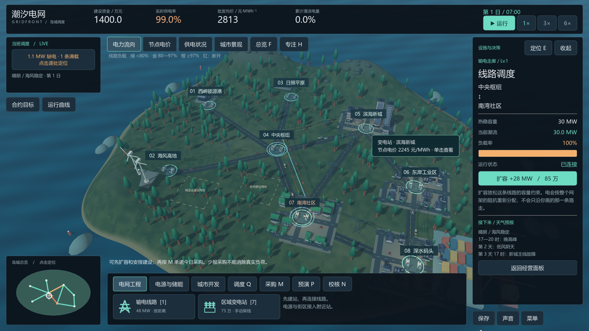
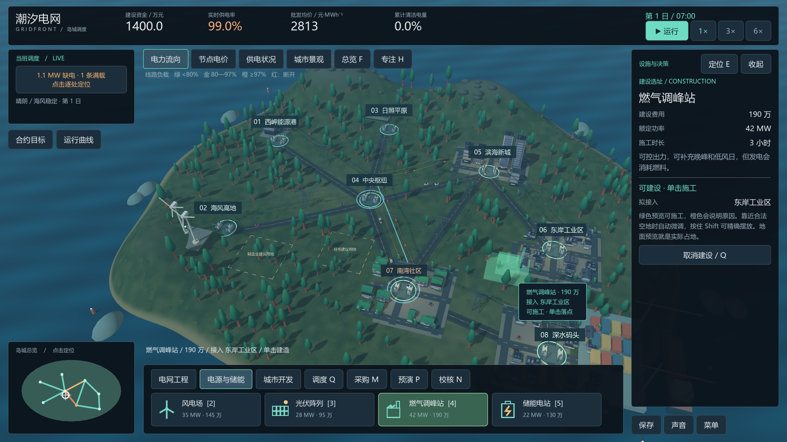
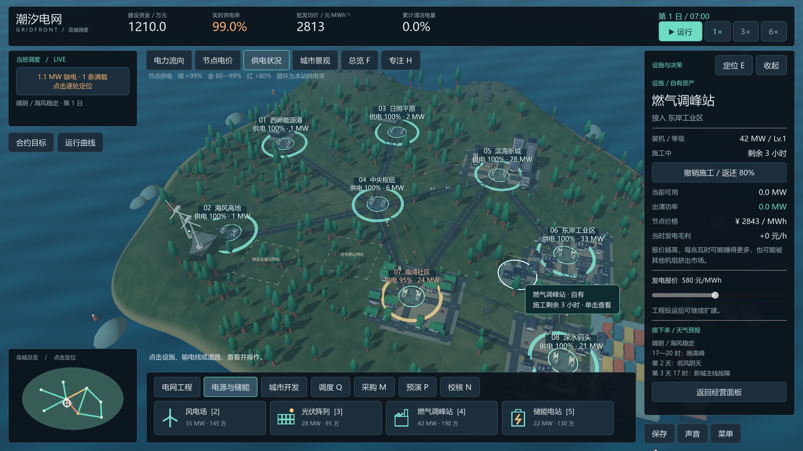
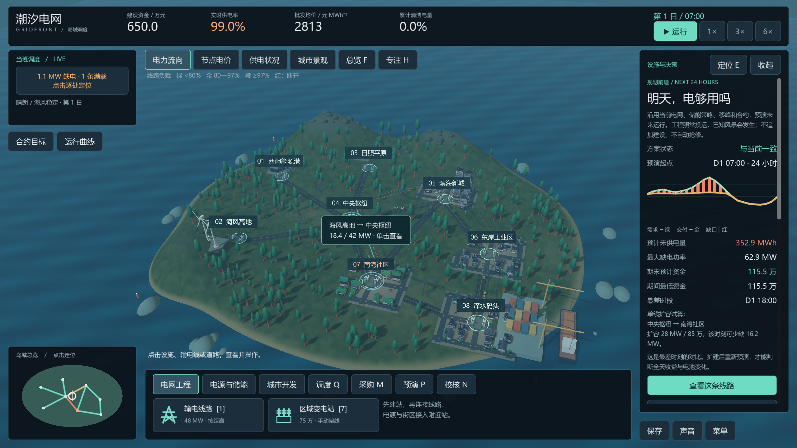
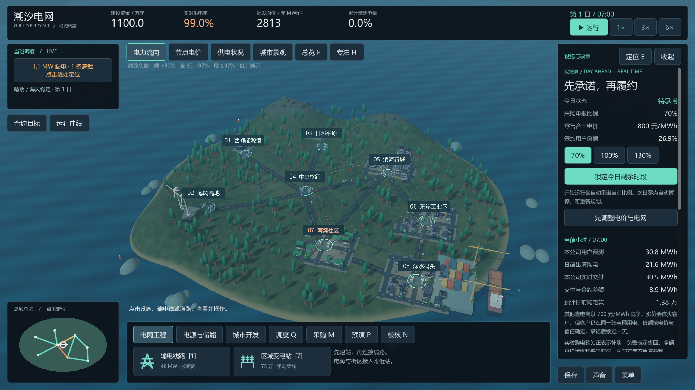
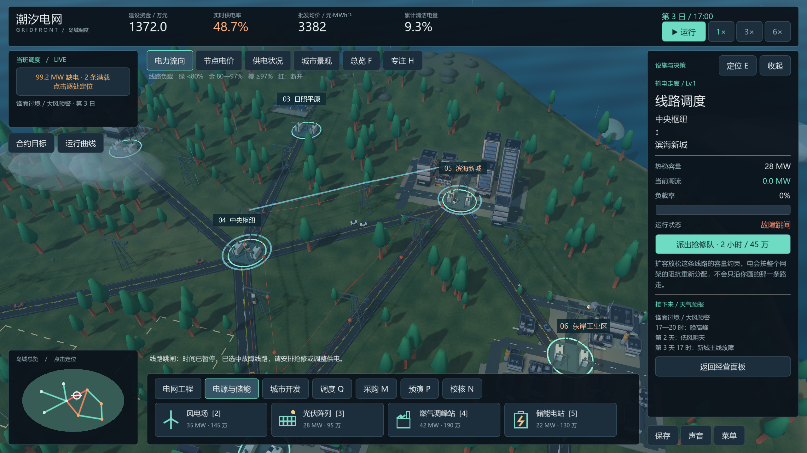
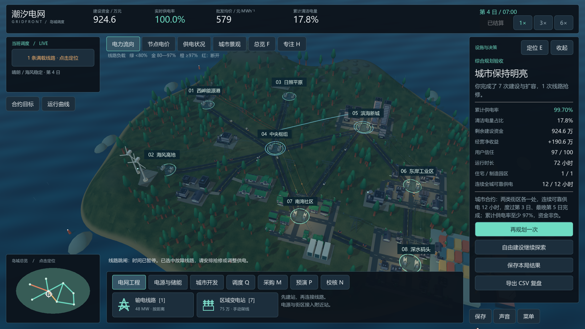

# 潮汐电网 · GRIDFRONT

一款可操作的 3D 电网规划与电力市场模拟游戏。你要在城市增长、网架容量、发电出力和购售电合同之间做取舍：修路开发街区会带来新的负荷；建设电源和线路才能把电送过去；拥堵、天气和故障会改变供电与结算结果。

**[下载 Windows x64 免安装试玩包](https://github.com/dclichang2022/gridfront/releases/latest)** · 解压后运行 `Gridfront-Market.exe`。包内附操作说明、机制说明和第三方许可。当前版本为 **V18 试玩版**。

## 一局里做什么

1. 在三维地图上查看变电站、线路、发电设施和街区，修路、建站、接线，扩建容易拥堵的通道。
2. 看 24 小时预演：找出缺电时段，检查是电源不足、线路卡住，还是街区尚未接通，再决定投资。
3. 每天决定日前采购量和零售报价。实际用电、天气与故障会形成实时偏差，影响现金和客户份额。遇到线路故障时，游戏会停下，留给你抢修决策。

可从“综合规划合约”开始，将城市建设和市场结算放在同一局；也可以分别玩建设或市场模式。

## 游戏画面与机制

| 建设与接入 | 供电覆盖 |
| --- | --- |
|  |  |

| 24 小时规划预演 | 日前采购与零售 |
| --- | --- |
|  |  |

| 风暴故障与抢修 | 城市供电验收 |
| --- | --- |
|  |  |

这些截图均来自 V18 游戏实际运行画面。

## 模拟边界

电网采用带线路容量约束的简化直流经济调度，按小时处理发电、负荷、储能和节点价格；市场采用日前承诺与实时偏差结算。价格和费用是游戏参数，未用真实市场数据校准。这是帮助理解规划与交易之间因果关系的游戏，不能用于真实调度或投资决策。

由 Godot 4 制作。发行包内含 Godot、Kenney 素材和 godot-road-generator 的许可与署名文件。
